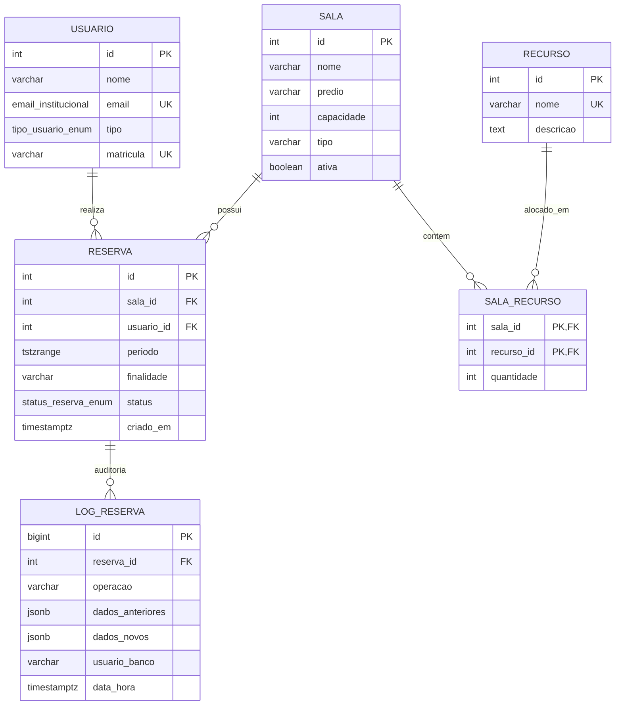

# Sistema de Reserva de Salas e Laboratórios

Aplicação CLI simples em Python conectada ao PostgreSQL, onde toda a lógica de negócio, validação de conflitos, auditoria e controle de acesso fica concentrada no banco de dados.

---

## Estrutura do Projeto

```text
├── sql/
│   ├── 01_init.sql       # Schema, constraints, triggers, functions, views e role app_reservas
│   ├── 02_seed.sql       # Dados iniciais e carga de 12.000 reservas com generate_series
│   └── 03_consultas.sql  # 5 consultas analíticas e comparativo EXPLAIN ANALYZE com 2 índices
├── app.py                # Interface CLI em Python (psycopg, sem ORM)
├── requirements.txt      # Dependência Python
├── docker-compose.yml    # Container PostgreSQL opcional
└── README.md             # Documentação do banco e testes
```

---

## Modelagem do Banco de Dados

### Modelo Conceitual (Entidades e Relacionamentos)

- **USUARIO** (1,N) realiza **RESERVA** (1,1)
- **SALA** (1,N) recebe **RESERVA** (1,1)
- **SALA** (0,N) possui **RECURSO** (0,N) — relacionamento N:N com atributo `quantidade` (materializado em `SALA_RECURSO`)
- **RESERVA** (1,N) gera **LOG_RESERVA** (0,1)

### DER Lógico



### Justificativa da 3ª Forma Normal (3FN)

- **1FN:** Todos os atributos são atômicos e não existem grupos repetitivos em uma mesma coluna (os recursos de cada sala foram separados na tabela associativa `sala_recurso`).
- **2FN:** Todas as tabelas possuem chave primária definida e os atributos não-chave dependem da chave completa. Em `sala_recurso(sala_id, recurso_id)`, `quantidade` depende da combinação inteira da sala e do recurso.
- **3FN:** Não existem dependências transitivas entre atributos não-chave. Informações do usuário (`nome`, `email`) ficam apenas em `usuario` e informações da sala (`predio`, `capacidade`) ficam apenas em `sala`, referenciadas por chave estrangeira em `reserva`.

### Justificativa das Políticas de `ON DELETE`

- `sala_recurso.sala_id -> ON DELETE CASCADE`: ao remover uma sala, seus vínculos de recursos são removidos junto.
- `sala_recurso.recurso_id -> ON DELETE RESTRICT`: impede excluir um recurso enquanto ele estiver alocado em alguma sala.
- `reserva.sala_id` e `reserva.usuario_id -> ON DELETE RESTRICT`: preserva a integridade do histórico impedindo apagar salas ou usuários que possuem reservas.
- `log_reserva.reserva_id -> ON DELETE SET NULL`: mantém o registro histórico de auditoria mesmo se uma reserva for removida administrativamente.

---

## Como Executar

### 1. Banco de Dados (PostgreSQL)

Execute os scripts da pasta `sql/` na ordem abaixo (via pgAdmin, DBeaver ou `psql`):

1. `sql/01_init.sql`
2. `sql/02_seed.sql`
3. `sql/03_consultas.sql` *(para rodar as 5 consultas analíticas e criar os 2 índices de desempenho)*

*(Opcional: caso utilize Docker, execute `docker compose up -d` para subir o PostgreSQL na porta `5432`.)*

### 2. Aplicação Python

```bash
pip install -r requirements.txt
python app.py
```

A aplicação conecta usando a role restrita `app_reservas` e disponibiliza as 4 operações no menu:
1. Listar agenda de uma sala no dia (`v_agenda_dia`)
2. Criar reserva (`criar_reserva`)
3. Cancelar reserva (`cancelar_reserva`)
4. Relatório de ocupação mensal (`mv_ocupacao_mensal` + `taxa_ocupacao`)

---

## Testes de Concorrência e Segurança

### Concorrência (Duas Sessões Simultâneas)

Para validar que duas sessões simultâneas não conseguem reservar a mesma sala no mesmo horário:

1. **Sessão 1:**
   ```sql
   BEGIN;
   SELECT criar_reserva(1, 1, '2026-12-20 14:00:00-03', '2026-12-20 16:00:00-03', 'Palestra');
   ```
2. **Sessão 2 (antes do `COMMIT` da Sessão 1):**
   ```sql
   BEGIN;
   SELECT criar_reserva(1, 2, '2026-12-20 15:00:00-03', '2026-12-20 17:00:00-03', 'Reuniao');
   ```
   A Sessão 2 fica bloqueada aguardando a resolução do índice GIST pela Sessão 1.
3. **Sessão 1:**
   ```sql
   COMMIT;
   ```
4. **Resultado na Sessão 2:** Assim que a Sessão 1 confirma, a constraint `sem_conflito` (`EXCLUDE USING gist`) rejeita a Sessão 2 com a mensagem:
   `ERROR: Conflito: A sala ja possui reserva ativa neste horario.`

### Segurança (`app_reservas`)

A role `app_reservas` não possui acesso direto às tabelas físicas, apenas `SELECT` nas views e `EXECUTE` nas funções (`SECURITY DEFINER`):

```sql
SET ROLE app_reservas;
SELECT * FROM reserva;       -- ERROR: permission denied for table reserva
SELECT * FROM v_agenda_dia;  -- Executa normalmente
RESET ROLE;
```
